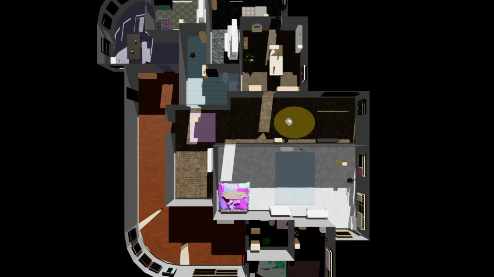
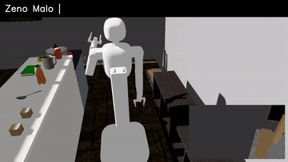

# SHIFT: A Benchmark for Task-Level Reasoning, Planning, and Substitution in Long-Horizon Mobile Manipulation

**S**ubstitution-aware **H**ousehold **I**nstruction **F**ollowing over long-horizon **T**asks

Based on instructions and observations of the environment, a robot interprets the task goal and its constraints,
determines which objects, tools, and destinations to use, organizes subgoals and skill invocations, and adjusts its
plan as new information becomes available to accomplish the overall task.

**[Explore the tasks ↗](https://zenobench-task-level-replanning-2026.zihan-liu.chatgpt.site/)** ·
Zeno Malo EDU mobile manipulator · Isaac Sim house with 10 rooms

<p align="center">
  
  
</p>

**30 household tasks · 151 variants · 316 preset layouts · 1,510 episodes**

## Categories

| category | variants | what it tests |
|---|---|---|
| Control | 30 | the nominal plan works; a reference for the other variants |
| Task-Level | 110 | interpret the goal and constraints, choose objects, destinations or procedures, revise the longer-horizon plan |
| Action + Task | 8 | longer-horizon planning that also needs local handling: opening storage, an edge position, an immediate obstacle |

## Variants and seeds

- **Variant**: a distinct problem design within a task, covering its goal, scene conditions, available resources,
  constraints and events. Different variants test different decisions, such as finding a substitute, identifying
  the target or choosing a destination.
- **Seed**: one reproducible initial scene of a variant, covering object placement, the robot's start pose and
  distractors. For a variant with several preset layouts, the seed also selects the layout. The core conditions
  the variant tests are kept.
- **Layout**: a concrete configuration of a variant (e.g. the cup in cabinet 4 or in cabinet 6), with its own
  instruction, goal predicates and reference contract sequence.

**1 episode = task + variant + seed.** Each variant uses seeds 10–19.

## Scoring

Scores are given per seed. The best feasible option earns 1.0. Substitutes in object, location or container earn
0.6 or 0.3, and an outcome that is not acceptable earns 0. Skipping a required instruction step also earns 0.
D = 1 marks a layout with several tiers, and D = 0 a layout with a single tier. Tiers are checked from highest to
lowest on the GT goal predicates of the final state. Incidental slips do not lower the score.

## Skills

The planner calls verb skills through contracts, one verb and one noun per call. Each contract checks GT pre- and
postconditions and selects a policy path by noun. See [skill_library/](skill_library/README.md),
[contract_library/](contract_library/README.md) and [policy_library/](policy_library/README.md).

<!-- library:start -->
**71 个动词 SkillNode**，一一对应 71 个 Contract，共 114 条按名词选择的 policy 路径，覆盖 85/117 个底层 policy（退役 32 个，见 [POLICY_COVERAGE.md](policy_library/POLICY_COVERAGE.md)）；前后条件来自 72 个 GT 谓词；关系图有 97 条上一步/下一步、40 条 fallback、47 条 alternative。

| 类别 | 动词 |
|---|---|
| 底盘与身体 | `navigate`, `face`, `retreat`, `crouch`, `stand`, `bend`, `straighten`, `tuck`, `reset`, `sidestep`, `wait` |
| 感知与手势 | `look`, `inspect`, `search`, `explore_room`, `point`, `present`, `identify`, `measure`, `count`, `wave`, `nod`, `explore_furniture`, `mark_spots` |
| 抓取与手 | `pick`, `place`, `drop`, `stack`, `release`, `handover`, `lift`, `lower`, `rotate`, `regrasp`, `brace`, `flip`, `shake`, `hover`, `square` |
| 非抓取接触与工具 | `push`, `pull`, `expose`, `separate`, `center`, `roll`, `tip`, `upright`, `wipe`, `stir`, `pour`, `touch`, `knock`, `sweep`, `dip` |
| 门、抽屉与电器 | `open`, `close`, `press`, `heat`, `chill`, `cover`, `uncover`, `stop` |
| 多物体（嵌套 Contract） | `fetch`, `collect`, `sort`, `clear`, `empty`, `arrange`, `restore`, `swap`, `hide` |
<!-- library:end -->

## Quick start

Requires Isaac Sim 5.1 + Isaac Lab 2.3 and cuRobo 0.7.8.

```bash
git lfs install && git clone <this repo> zeno-house && cd zeno-house
git submodule update --init --recursive      # baseline/graph_manager; run it again after every git pull
export OMNI_KIT_ACCEPT_EULA=YES ISAACLAB_PYTHON=/path/to/isaaclab/python

# one episode (task, variant, seed) through its reference contract sequence
$ISAACLAB_PYTHON benchmark/run_episode.py --tasks benchmark/v6/tasks.json --task T28_cup_to_bedside \
    --variant cup_out_of_view --seed 10 --planner oracle

# your planner: reset(instruction, skills) / next_call(observation), see benchmark/planners.py
$ISAACLAB_PYTHON benchmark/run_episode.py --tasks benchmark/v6/tasks.json --task T28_cup_to_bedside \
    --variant cup_out_of_view --seed 10 --planner recovery --policy mypkg.planner:MyPlanner

# HTTP service for an external planner
$ISAACLAB_PYTHON -m env_service.server --port 8800
```

## Repository layout

```text
benchmark/          task catalogs, episode runner, scoring
episode/            episode pipeline and observation profiles
env_service/        HTTP environment service
skill_library/      verb skills, relations, planner
contract_library/   one contract per skill
policy_library/     low-level policies
zeno_skills/        kinematics, planning, perception, predicates, skill runtime
sim/, usd/, tasks/  house, robot, assets and task scenes
annotations/        GT annotations for every asset
assets/             EmbodiedGen V2 asset sources
docs/               design notes and guides (index: docs/README.md)
```

## Acknowledgements

House layout: [Infinigen](https://github.com/princeton-vl/infinigen) (BSD-3). Assets:
[EmbodiedGen](https://github.com/HorizonRobotics/EmbodiedGen) V2 (Apache-2.0). Robot: Zeno Malo EDU description
(see `robot_sources/zeno_malo_description-master/LICENSE`).

<!-- verification:start -->
<!-- verification:end -->
<!-- rollouts:start -->
<!-- rollouts:end -->
